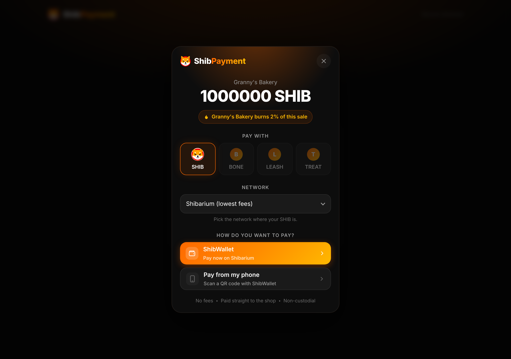
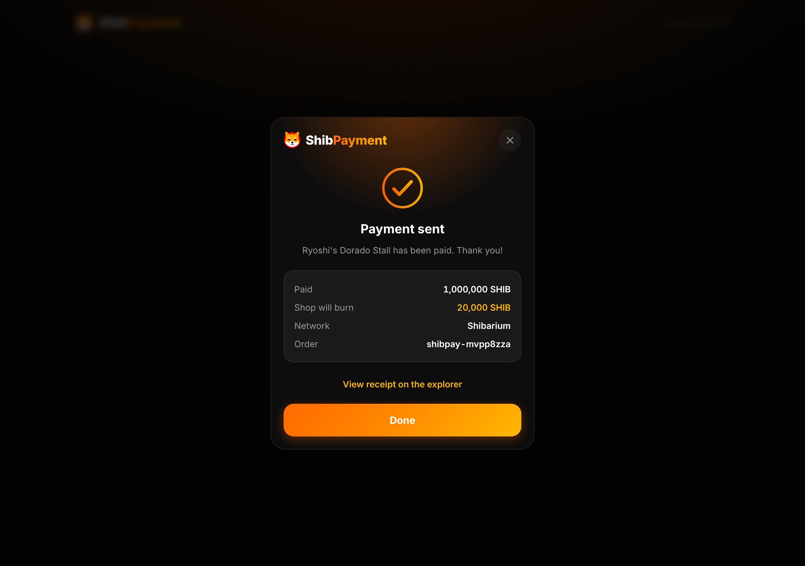
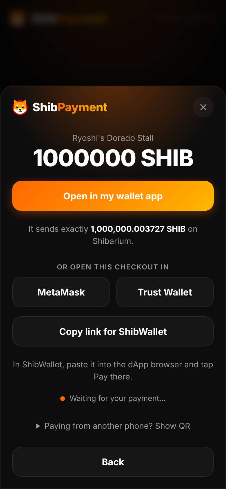
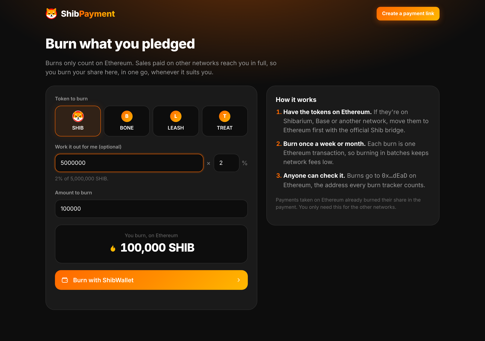
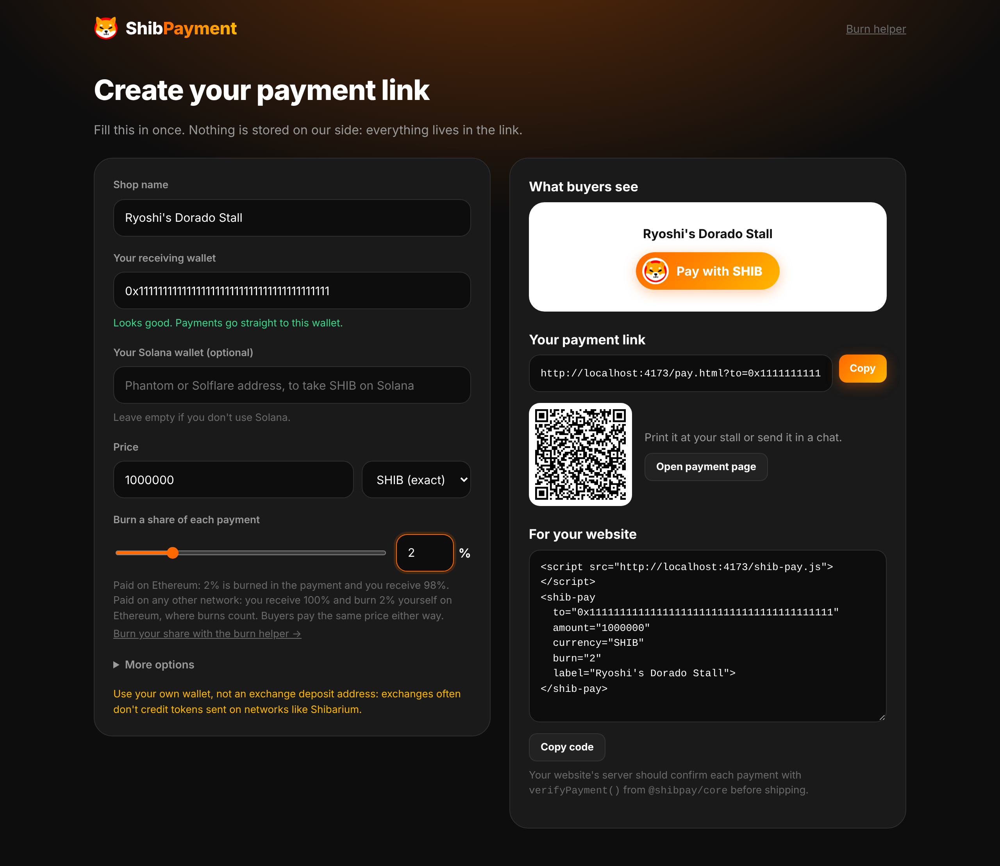
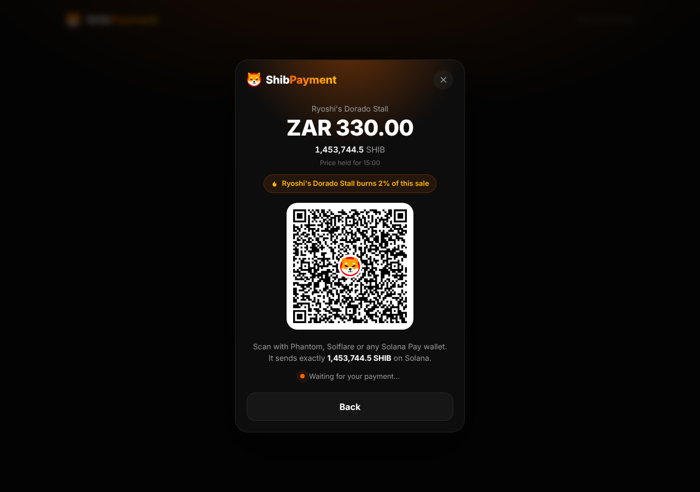

# ShibPayment

Free, non-custodial **Pay with SHIB** for any shop. A merchant pastes their wallet address, sets a price, and shares a link or drops one button on their website. Buyers pay with **SHIB, BONE, LEASH or TREAT** on any of the **13 networks** where those tokens live, straight into the merchant's wallet.

- **No fees.** ShibPayment never takes a cut and never holds money. Shibarium's built-in burns are the only "fee".
- **Optional burn.** A merchant can pledge a share of every sale to burn. Burns only count on Ethereum, so payments on Ethereum burn it in the same transaction, and for every other network the merchant burns their share on Ethereum with the burn helper (`/burn.html`).
- **Granny-simple.** No account, no sign-up, no crypto words on the default screens.

| Checkout | Paid | Phone |
| --- | --- | --- |
|  |  |  |

## What's in here

| Path | What it is |
| --- | --- |
| `packages/chains` | Chain and token registry: 13 EVM networks and 41 token deployments, copied from ShibWallet, plus SHIB on Solana (bridged by Sunrise). |
| `packages/contracts` | `ShibPaySplitter.sol`, the burn splitter, compiled with solc-js; deploy script. |
| `packages/core` | The SDK: quotes, payment links, paying through any EIP-1193 wallet, on-chain verification, payment search, and Solana Pay for SHIB on Solana. |
| `packages/button` | `<shib-pay>`, a framework-free web component built to one script, `shib-pay.js`. |
| `apps/woocommerce` | ShibPayment for WooCommerce, the WordPress plugin. Built to `shibpayment-woocommerce.zip` on the website. |
| `apps/web` | The website: landing page, merchant link builder (`/setup.html`), hosted payment page (`/pay.html`) and burn helper (`/burn.html`). |

## For merchants

Open `/setup.html`, fill in your shop name, your receiving wallet (an address, or a `.shib` / `.eth` name), a price and an optional burn %. Add a Solana wallet (Phantom, Solflare…) too if you want to take SHIB on Solana. You get:

- a **payment link** and **QR code** to share in chats or print at a stall,
- an **embed snippet** for your website.

Use your own wallet, not an exchange deposit address: exchanges often don't credit tokens sent on side networks.

If you set a burn, open `/burn.html` once a week or month: enter what you took in on networks other than Ethereum, and it burns your share from your wallet on Ethereum in one transaction. Your tokens need to be on Ethereum for that; bridge them there first if they aren't.





## For WooCommerce

Download `shibpayment-woocommerce.zip` from the website (`/shibpayment-woocommerce.zip`), then in WordPress: **Plugins → Add New → Upload Plugin**, activate it, and open **WooCommerce → Settings → Payments → Pay with SHIB**. Paste your wallet (or .shib name), set a burn % if you want, tick **Turn on**, save.

At checkout the buyer picks **Pay with SHIB** (classic and block checkout both work), and the payment window opens with the order's total and number filled in. The plugin then checks the payment on-chain from your server, in PHP, with the same rules as `verifyPayment()`, and marks the order paid:

- A plain transfer must carry the order's 4-digit code in its amount (the plugin hands it to the button as `tag`) and be newer than the order. A payment to you that doesn't carry the code is put **on hold** for you to look at, rather than accepted or refused, since it may be someone else's.
- SHIB on Solana, when the shop adds a Solana wallet in the settings: each order gets its own Solana Pay `reference` (handed to the button as `reference`), the payment must carry it and be final, and the server looks the reference up every minute for half an hour, so a buyer who paid by QR and closed the page is still matched. An optional Solana connection URL (Helius, QuickNode…) makes this steadier than the public endpoint.
- One transaction can only pay one order.
- The amount is checked against CoinGecko's price in your shop currency, allowing 3% for price movement while the buyer's quote is held.
- Payments still waiting for confirmations are rechecked every 30 seconds for an hour.
- Buyers who paid from a phone wallet and closed the page can paste the transaction link on the order's payment page.
- Pledged burns are added up on the settings page, with a link to the burn helper.

The plugin carries its own copy of `shib-pay.js`, so checkout doesn't depend on this website being up. It needs PHP 8.0+, WooCommerce 8+, and no PHP extensions beyond the usual ones (keccak-256 and uint256 sums are done in plain PHP). Network lists and token addresses are generated from `packages/chains` (`npm run data -w @shibpay/woocommerce`), and a test fails if they drift apart.

## For websites

```html
<script src="https://YOUR-SHIBPAYMENT-SITE/shib-pay.js"></script>

<shib-pay
  to="0xYourWalletAddress"
  amount="330" currency="ZAR"
  burn="2" order="A-1017"
  label="Ryoshi's Dorado Stall"
  return-url="https://yourshop.com/thank-you">
</shib-pay>
```

One button covers the whole checkout: have your page fill `amount` and `order` from the cart (for example `amount="{{ cart.total }}" order="{{ order.id }}"` in a template), or update them from JavaScript with `setAttribute`, and the button picks up the change. Shops without a cart can make one button or payment link per item.

| Attribute | Meaning |
| --- | --- |
| `to` | Merchant's receiving address (required). |
| `sol` | Optional Solana wallet. Adds Solana to the networks for SHIB, paid with Solana Pay. |
| `reference` | Optional Solana Pay reference (a base58 public key). Your server's key for this order, so it can find the payment by it. Random when left out. |
| `solana-rpc` | Optional Solana RPC URL. The public one works but is rate-limited; a free Helius or QuickNode key is steadier for a busy shop. |
| `amount`, `currency` | Price. `currency` is a fiat code (USD, EUR, NGN, INR…) converted at checkout via CoinGecko, or a token symbol (`SHIB`) to charge an exact token amount. |
| `burn` | Percent of each sale to burn, 0 to 100 (default 0). Burned in the payment on Ethereum; a pledge on other networks. |
| `order` | Your order reference. With a burn, it is recorded on-chain in the payment event. |
| `label` | Shop name shown to the buyer. |
| `tokens` | Comma list to limit tokens, e.g. `SHIB,BONE`. |
| `return-url` | Where to send the buyer after paying; `shibpay_tx`, `shibpay_chain` and `shibpay_order` are appended (on Solana, `shibpay_chain=solana` and `shibpay_ref` too). |
| `theme="dark"` | Dark trigger button instead of the orange one. |
| `tag` | Optional 1 to 9999. Your server's code for this order, put in the amount's 3rd to 6th decimals so you can tie a plain transfer to its order. Random when left out. |

The element fires `shibpay:paid` with `{ txHash, chainId, token, amount, burnMode, burned, pledged, payer, order, merchant }`. `burnMode` is `in-tx` (burned in the payment), `pledge` (the shop was paid in full and `pledged` is theirs to burn on Ethereum) or `none`.

**Always verify on your server** before marking an order paid. Anything the browser says can be faked:

```ts
import { publicClientFor, verifyPayment } from '@shibpay/core';

const result = await verifyPayment(publicClientFor(chainId), txHash, {
  chainId, token: 'SHIB', merchant: '0xYourWallet', amount: expectedAmount, burnBps: 200, orderId: 'A-1017',
});
if (result.ok) markPaid(result.pledged); else if (result.retry) tryAgainLater(); else reject(result.reason);
```

`result.pledged` is the burn you owe for that sale, so you can total it up for the burn helper.

For a Solana payment (`chainId` is `"solana"` in the event), check the signature, and the checkout's `reference` from the event or `shibpay_ref`:

```ts
import { verifySolanaPayment } from '@shibpay/core';

const result = await verifySolanaPayment({ url: 'https://your-solana-rpc' }, signature, {
  recipient: 'YourSolanaWallet', amount: expectedAmount, reference, burnBps: 200, // amount in the token's smallest units
});
if (result.ok) markPaid(result.pledged); else reject(result.reason);
```

It waits for `finalized` by default, about 13 seconds after the payment, after which it can't be rolled back. `findSolanaPayment(rpc, reference)` finds a payment for a reference if you only have that.

## How a payment works

- **Plain transfer** (no burn, or any network other than Ethereum): one ordinary token transfer from buyer to merchant. No contract is involved. A plain transfer carries no order number, so each quote gets a unique amount (a tag in the 3rd to 6th decimals), which lets `findPayment()` match QR payments to their order.
- **Burn on Ethereum**: the buyer approves the exact amount, then calls `ShibPaySplitter.pay()`, which sends the burn share to `0x000000000000000000000000000000000000dEaD` and the rest to the merchant in one transaction, and emits `Paid(orderId, payer, merchant, token, amount, burned)`. Wallets that can bundle calls ([EIP-5792](https://eips.ethereum.org/EIPS/eip-5792), such as MetaMask smart accounts and Coinbase Wallet) get the approval and the payment in one confirmation; others confirm twice. None of SHIB, BONE, LEASH or TREAT supports `permit`, so a signature can't replace the approval.
- **Burn pledge** (other networks): burning a bridged copy of SHIB on Base or Shibarium doesn't reduce supply, because the original stays locked in the bridge on Ethereum, and burn trackers only count Ethereum. So the merchant is paid in full, and the checkout shows the shop's pledge. The merchant settles it with `burnOnEthereum()` (the burn helper page), a plain transfer to `0x…dEaD` on Ethereum. No contract is needed on any other chain.
- **SHIB on Solana**: a [Solana Pay](https://docs.solanapay.com/spec) transfer of Sunrise's SHIB to the merchant's Solana wallet, carrying a random `reference` key per checkout so the payment can be found and tied to its order without a unique amount. Buyers pay from Phantom, Solflare or any Solana wallet in the browser, or tap or scan the `solana:` link on a phone. The checkout creates the merchant's SHIB account if it has none (the buyer pays its rent, about 0.002 SOL). Burns are always a pledge here, because only Ethereum burns count. The SDK builds this transaction itself, without a Solana library, and the tests check it against `@solana/web3.js` and `@solana/spl-token`.
- Before asking the wallet to sign, the SDK checks the buyer's balance, so a buyer who can't afford it never pays gas for a failed transaction.



### ShibPaySplitter

- No owner, no fee, not upgradeable, holds nothing between calls.
- Only ever pulls from `msg.sender`, so an approval to it cannot be spent by anyone else (there is a test for exactly that).
- Deployed on Ethereum only, through the CREATE2 deployer, at **`0xd25D81E6BF55465BAbe85eA543EB6e8bCbFaba82`** (from `npm run compile`; it changes if the contract or compiler changes).
- The burn rounds down; dust goes to the merchant.

Until the splitter is deployed, Ethereum payments fall back to a pledge too, and verification accepts that. Deploying it is optional: it only moves Ethereum burns from "the shop burns later" to "burned in the payment". To deploy from a browser with Remix or MetaMask, follow [docs/splitter-deploy](docs/splitter-deploy/DEPLOY-WITH-REMIX.md). From the repo (the key only pays gas and gets no rights):

```sh
npm run compile
PRIVATE_KEY=0x... npm run deploy -w @shibpay/contracts
```

The contract has not had an external audit yet.

## Networks and tokens

| Network | SHIB | BONE | LEASH | TREAT |
| --- | --- | --- | --- | --- |
| Shibarium | ✓ | ✓ (native gas coin) | ✓ | ✓ |
| Ethereum | ✓ | ✓ | ✓ | ✓ |
| BNB Chain, Arbitrum One, OP Mainnet, Base, Polygon, Scroll, Linea, Celo, Gnosis, Mantle, Avalanche | ✓ | ✓ | ✓ | not deployed |
| Solana (Sunrise) | ✓ | | | |

Addresses come from ShibWallet's `src/lib/tokens.ts`, which verified each against the Chainlink CCIP directory, shib.io and an on-chain `symbol()` call. Impostor tokens with the same names exist, so payments are only ever matched by address. SHIB on Solana is `shib5gSoVKPjwkXrxRk7SbQFzb2R9rQB3TgQWYX4RwW`, copied from Sunrise's SHIB page on sunrise.xyz (the source Sunrise's docs say to trust) and matching Jupiter, Solscan and tokens.xyz. Its decimals are read from the chain at payment time. At least seven other Solana tokens call themselves SHIB, shibwifhat among them, so Solana payments are matched by mint too.

## Development

```sh
npm install
npm test          # compiles the contracts, then runs unit, contract and end-to-end tests
npm run typecheck
npm run build     # builds shib-pay.js and the website into apps/web/dist
npm run dev       # website on http://localhost:5173 (build the button first for /shib-pay.js)
```

The tests run an in-process EVM (ganache) posing as Ethereum or Shibarium, with the test token's code at that chain's real SHIB address and the splitter at its real CREATE2 address, so the SDK is tested unmodified: approve, pay, burn, pledge, verify, and every way of misreporting a payment.

## Hosting

The site is a static build. `vercel.json` sets everything for Vercel: import the repo, leave the root directory as the repo root, and deploy. (Install `npm ci`, build `npm run build`, output `apps/web/dist`, Node 22.) Only `main` deploys; branches and PRs get no preview builds, to save build minutes.

## Roadmap

1. **Now:** button, payment links, link builder, burn helper, Ethereum burn splitter, WooCommerce plugin, 13 EVM networks, SHIB on Solana (in the button, links and the plugin).
2. **Next:** deploy the splitter on Ethereum, ShibWallet opening payment links directly, bridge-then-burn in one tap once ShibWallet's CCIP sending is wired up.
3. **Then:** WalletConnect, more shop platforms.
4. **Later:** supply-chain provenance on Shibarium.
